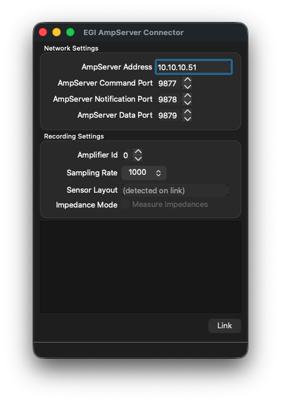

# LSL EGI AmpServer Application

## Usage

This program should work with any amplifier that works with the AmpServer produced by EGI (http://www.egi.com/).
All communication with the amplifier happens through the Amp Server's low-level Network Protocol. Amp Server Pro SDK is [documented here](https://www.egi.com/images/stories/manuals/amp-server-pro-sdk-3-0-user-guide-rev-01.pdf).
 and the [network API here](https://www.egi.com/images/stories/manuals/amp-server-pro-sdk-3-0-network-apis-user-guide-rev-01.pdf).

  * Make sure that your AmpServer is running and can correctly record from its connected amplifier(s).

  * Start the EGIAmpServer app. You should see a window like the following.
> > 

  * Make sure that you have the correct IP address of the AmpServer assigned. The ports correspond to the default settings of the server and should not require a change.

  * If you have multiple amplifiers connected to the AmpServer and you would like to record from a specific one, you need to set the correct amplifier ID (these should be increasing from zero). Also make sure that you are using a supported number of channels and a supported sampling rate (the defaults should work).

  * To link the application to the LSL, click the "Link" button. If all goes well you should now have a new stream on the network with name "EGI NetAmp k" (k corresponding to the index of the amplifier) and type "EEG". If you get an error you might try to manually power on the desired Amp and try to link while it is either recording or stopped.

  * For subsequent uses you can save the desired settings from the GUI via File / Save Configuration. If the app is frequently used with different settings you might make a shortcut on the desktop that points to the app and appends to the Target field of the shortcut the snippet `-c name_of_config.cfg` to denote the name of the config file that should be loaded at startup.

## Command-Line Interface

The CLI provides a lightweight alternative to the GUI:

```bash
./EGIAmpServerCLI [options]
```

### Options
- `--config <file>` - Load configuration from file
- `--address <addr>` - AmpServer IP address (default: 10.10.10.51)
- `--cmd-port <port>` - Command port (default: 9877)
- `--data-port <port>` - Data port (default: 9879)
- `--amp-id <id>` - Amplifier ID (default: 0)
- `--sample-rate <hz>` - Sample rate in Hz (default: 1000). Forces amplifier to this rate if already running at a different rate. Valid rates depend on the amplifier model — see [Sample Rate Modes](#sample-rate-modes). Unsupported combinations are rejected with an error before the amplifier is touched.
- `--fast-recovery` - Use native rate mode (no FPGA anti-alias filter) for lower latency. See [Sample Rate Modes](#sample-rate-modes).
- `--impedance` - Enable impedance testing mode
- `--native-format` - Transmit raw int32 ADC counts instead of float microvolts
- `--shutdown` - Shutdown the Amp Server (terminates all connections)
- `--help` - Show help message

### Example
```bash
# Basic usage
./EGIAmpServerCLI --address 10.10.10.51

# With impedance testing
./EGIAmpServerCLI --address 10.10.10.51 --impedance

# With native format (int32 ADC counts)
./EGIAmpServerCLI --address 10.10.10.51 --native-format

# Low-latency mode (fast recovery / native)
./EGIAmpServerCLI --address 10.10.10.51 --sample-rate 1000 --fast-recovery

# Decimated mode — timestamp compensation is applied automatically
./EGIAmpServerCLI --address 10.10.10.51 --sample-rate 1000
```

## Connecting to an Already-Running Amplifier

When another application (e.g., Net Station Acquisition) has already started the amplifier, the CLI's behavior depends on whether you pass any rate or mode flags.

### Default: Non-Destructive Attach

With no rate flags, the CLI detects the running amplifier, measures its current sample rate from the data stream, and attaches without disrupting the existing session:

```bash
# Attaches to whatever rate/mode the amp is already using
./EGIAmpServerCLI --address 10.10.10.51
```

This is safe to use alongside Net Station — it will not stop or reconfigure the amplifier.

### Forcing a Rate or Mode

The following flags cause the CLI to stop, reconfigure, and restart the amplifier — even if it was started by another application:

- `--sample-rate <hz>` — reinitializes if the detected rate differs from the requested rate. At 500/1000 Hz, where native and decimated are indistinguishable in the data stream, requesting a decimated rate also forces reinitialization to guarantee decimated mode (so the automatic [timestamp compensation](#timestamp-compensation) is correct)
- `--fast-recovery` — reinitializes to ensure native (unfiltered) mode

**Warning**: Reinitialization will interrupt any active Net Station recording. If you need to coexist with Net Station, omit these flags and let the CLI match the existing configuration.

### Recovery During Streaming

If the amplifier is stopped or restarted externally while the CLI is streaming:

- **Amp powered off by another app** (e.g., Net Station clicks "Off"): The CLI detects stream loss and attempts to reinitialize the amplifier with its original settings.
- **Amp restarted by another app** (e.g., Net Station reconnects): The CLI detects the new stream, adapts to whatever rate the other app configured, and recreates its LSL outlets if the rate changed.
- **Amp power-cycled or shutdown**: The CLI waits up to 120 seconds for recovery before giving up.

## Sample Rate Modes

The NA400/NA410/NA500 amplifiers support two operating modes that affect anti-aliasing and latency:

### Decimated Mode (Default)

Uses the FPGA's digital anti-aliasing filter to downsample from the ADC's native rate. This provides:
- Better frequency response (~400 Hz bandwidth at 1000 Hz sample rate)
- On the NA400, higher latency due to the filter group delay (36-111 ms depending on rate), which the app compensates for automatically — see [Timestamp Compensation](#timestamp-compensation)

Available decimated rates: 250, 500, 1000 Hz (NA400/NA410); 250, 500, 1000, 2000 Hz (NA500)

### Native Mode (Fast Recovery)

Bypasses the FPGA filter and samples directly at the requested rate. This provides:
- Lower latency (no filter group delay)
- Reduced bandwidth (~1/4 of sample rate, e.g., 250 Hz at 1000 Hz sample rate)
- Optimized for EEG-TMS and real-time BCI applications

Available native rates: 500, 1000, 2000, 4000, 8000 Hz (NA400); 250, 500, 1000, 2000, 4000 Hz (NA500)

Use `--fast-recovery` (or a "Low Latency" dropdown entry) to select native mode for rates where the model offers both.

The GUI dropdown shows the union of both models' rates; the client validates the selection against the amplifier's actual model right after it identifies itself and refuses unsupported combinations with a clear error.

### Filter Delay by Sample Rate

DIN→EEG group delay of the FPGA anti-alias filter (decimated mode only). NA400 values measured with `scripts/delay_capture_sweep.py`:

| Amp | Mode | Sample Rate | Filter delay (ms) | (samples) |
|-----|------|-------------|-------------------|-----------|
| NA400 | Decimated | 250 Hz | 111 | ~28 |
| NA400 | Decimated | 500 Hz | 61 | ~30 |
| NA400 | Decimated | 1000 Hz | 36 | 36 |
| NA400 | Native | 500-8000 Hz | 0 | 0 |
| NA500 | any | all rates | 0 | 0 |

The NA500 rows are zero deliberately: Net Station 6 applies no anti-alias alignment shift for the NA500 (verified against Net Station 6.0.0.60960), so this app matches that behavior. If a real NA500 filter delay is ever measured, update `resources/sampling_rates.json`.

## Net Amps 500 (GES 500) Support

NA500 support was verified against real hardware (firmware 0.4.9). The amplifier's protocol is documented, as observed on the wire, in [docs/NA500_AmpServer.md](docs/NA500_AmpServer.md).

**Finding the amplifier**: the NA500 gets its address by DHCP and advertises itself over mDNS (service `_na500._tcp`), typically as `NA500-256ch-<serial>.local`. Pass that name instead of an IP, e.g. `--address NA500-256ch-0001.local`. This works out of the box on macOS and recent Windows 10/11; Linux needs Avahi with `nss-mdns`. To list amplifiers on the network, run `dns-sd -B _na500._tcp` (macOS/Windows with Bonjour) or `avahi-browse -r _na500._tcp` (Linux). With no DHCP server on the network the amplifier has no IPv4 address, and this app cannot reach it because its AmpServer is IPv4-only.

Differences from the NA400 that this app handles automatically:

- **Scaling**: 0.044703 µV/bit (±375 mV over 24 bits, matching the GES 500 datasheet and Net Station 6).
- **Rates**: decimated up to 2000 Hz; native from 250 Hz up to 4000 Hz. No duplicate packets are sent at low rates (the NA400 duplicates samples below 1000 Hz). 8000 and 16000 Hz are not offered: the amplifier accepts them but delivers at most about 7995 samples/s, and the missing samples leave no gap in its packet counter (about 4 samples/s lost at 8000 Hz, half at 16000 Hz).
- **Initialization**: the NA500 silently ignores commands sent while it is powering up (~10 s from cold), so the app waits for the power-on notification before configuring it.
- **Data connection handling**: the NA500's AmpServer serves one data listener per session; once it disconnects, no new listener is served until the command connection closes and a new session starts. The app therefore maintains one persistent data connection per session and never issues `cmd_StopListeningToAmp` (which the NA500 never answers).
- **Continuous reading**: the NA500 drops samples if its data port goes unread for a few seconds, so the app does not wait for a Physio16 status notification (the NA500 sends none).
- **Stale packets**: after `cmd_Start` the NA500 first resends leftover packets from its previous stream before its counter restarts at 0; the app discards them.
- **Front end**: the NA500's EEG reads full scale until its buffered reference is switched on, every `cmd_Stop` switches it off, and switch commands sent within ~20 ms of power-on are lost; the app waits briefly after power-on and enables the buffered reference before each `cmd_Start`.
- **Physio16**: the NA500 never reports whether a Physio16 is attached, so the app always streams its 16 physio channels (PIB1-16) after the EEG. Physio gains persist on the amplifier, so the app sets them to 12, the power-on default, before each start; the physio is then scaled like the EEG (±375 mV range) and needs no realignment delay.
- **Clock**: the NA500 stamps packets with its own clock, which is not synchronized; the app sets it with `cmd_SetAmpTime` at power-on, as Net Station does.
- **Single client**: while Net Station (or any other client) is linked to the NA500, this app's connections are accepted but not serviced — and vice versa. Unlink Net Station before using this app; concurrent monitoring is not possible on the NA500 (unlike the NA400).
- **Recovery**: the NA500 sends `ntn_AmpStarted` only in reply to `cmd_GetStartTime`, not when streaming starts, so external-restart recovery uses data-port polling instead.
- **Robustness**: the NA500's embedded AmpServer (fw 0.4.9) can crash or stop responding after abrupt client disconnects; commands now time out after 10 s instead of hanging, and the GUI performs linking on a background thread so the UI never freezes. A crashed AmpServer requires power-cycling the amplifier.

## Timestamp Compensation

The application adjusts the LSL timestamp it assigns to each sample so that the timestamp reflects **when the signal actually occurred**, not when the bytes happened to arrive at this client. This makes EEG, Physio16, and DIN events line up with each other and with external event markers. Three corrections are applied; together they are what we call timestamp compensation.

There is **no flag to toggle this** — it follows the configured mode automatically. The app trusts the mode you configure: a decimated rate means the filter corrections apply; a native rate (`--fast-recovery`, or any rate above 1000 Hz) means they do not. At 500/1000 Hz, where native and decimated are indistinguishable in the data stream, the app assumes the mode you asked for (and, when forcing a rate, reinitializes to guarantee it).

### 1. System (pipeline) delay — always applied

Every pushed timestamp (EEG, Physio16, **and** DIN) is moved earlier by `systemdelayms` to account for the time between digitization and the sample becoming available here: device firmware + network transmission + our read path. Measured using `scripts/audio_latency_test` at ~5 ms on the NA400, and on the NA500 at ~1.0 ms plus 1.1 sample periods (5.4 ms at 250 Hz, 2.1 ms at 1000 Hz, 1.3 ms at 4000 Hz).

The default is **4.5 ms** (NA400 and other models) and **0.8 ms + one sample period** on the NA500 (4.8 ms at 250 Hz, 1.8 ms at 1000 Hz) — deliberately a little *under* the measured value. Under-compensating is the safe direction: it guarantees a sample is never back-dated to *before* the event that produced it (a response must not precede its stimulus). It is user-configurable; raise it toward the measured latency if you prefer tighter alignment and can accept that risk.

### 2. FPGA filter offset — decimated mode only

In decimated mode the anti-alias filter delays the EEG relative to the (unfiltered) DIN by the group delay in the table above (111/61/36 ms at 250/500/1000 Hz). The app subtracts this from the EEG/Physio timestamps so filtered EEG lines up with DIN. Native mode has no filter, so nothing is subtracted. DIN itself is never filter-shifted (only the system delay applies to it).

### 3. Physio16 realignment — decimated mode only

The Physio16 (PNS/PIB) acquisition path runs **ahead** of the FPGA-filtered EEG by a fixed ~33 ms in decimated mode, so the same event lands at different sample indices in the EEG vs physio channels of the combined stream. To keep them sample-aligned, the physio channels are buffered (delayed) by `physioaligndelayms` (default **33 ms**, applied as `floor(33 ms × rate)` samples). The physio channels therefore read **zeros for the first ~33 ms** after streaming starts, then real data. Native mode applies no physio delay.

### Configuration

Both values live in the config file (and persist via File → Save Configuration):

```xml
<settings>
  ...
  <physioaligndelayms>33</physioaligndelayms>   <!-- Physio16 realignment, decimated only -->
  <systemdelayms>4.5</systemdelayms>            <!-- pipeline-latency compensation, always; omit for the per-model default -->
</settings>
```

The filter-offset values (111/61/36 ms) are built in. All three were measured on real hardware; see `scripts/audio_latency_test/README.md` (system delay) and `notebooks/delay_inspection.ipynb` (filter and physio delays).

### Coexisting with Net Station

The filter corrections are only correct when the operating mode is known. If another application (e.g. Net Station) already started the amplifier at an ambiguous rate (500/1000 Hz), the app applies the corrections for the mode **you configured**, assuming it matches. If you are unsure of the running mode, attach with a native configuration (no filter corrections) or let the app reinitialize to a known mode (which interrupts the existing session).

## Impedance Testing

The application supports electrode impedance measurement using the same algorithm as Net Station Acquisition.

### Overview

When impedance mode is enabled:
- The amplifier is configured for impedance measurement (20 Hz calibration signal)
- **Two LSL streams are created**:
  1. **EEG Stream** (`type: EEG`) - Raw amplifier data containing the calibration signal
  2. **Impedance Stream** (`type: Impedance`) - Calculated impedance values in kilo-ohms
- The application cycles through each channel, measuring impedance one at a time
- A complete scan of all channels takes approximately 1-5 minutes depending on channel count

### How It Works

The impedance measurement follows Net Station's algorithm:

1. **Initial State**: All channels are "driving" the 20 Hz calibration signal
   - Drive signals ON, 10K resistors OFF for all channels
   - Oscillator enabled at 20 Hz sine wave, maximum amplitude (4095)

2. **Per-Channel Measurement**: For each channel:
   - Turn OFF the drive signal (isolate channel from calibration)
   - Turn ON the 10K reference resistor
   - Wait ~1 second for signal to settle
   - Measure peak-to-peak amplitude from collected samples
   - Calculate impedance using: `Z = (idealSignal - amplitude) / (amplitude / 10)`
   - Reset channel back to driving state

3. **Output**: After measuring all channels, the impedance values (in kOhms) are pushed to the LSL impedance stream

### Enabling Impedance Mode

#### Via CLI
```bash
./EGIAmpServerCLI --address 10.10.10.51 --impedance
```

#### Via Configuration File
Add to your `ampserver_config.cfg`:
```xml
<settings>
  <impedance>true</impedance>
  <!-- other settings -->
</settings>
```

### LSL Streams Created

#### 1. EEG Stream
- **Name**: `EGI NetAmp <amp_id>`
- **Type**: `EEG`
- **Rate**: Configured sample rate (e.g., 1000 Hz)
- **Channels**: Depends on sensor net (32-256 channels)
- **Format**: `float32` (default) or `int32` (with `--native-format`)
- **Unit**: `microvolts` (default) or `counts` (with `--native-format`)
- **Behavior**: Streams continuously with raw amplifier data (contains 20 Hz calibration signal during impedance mode)

##### Native Format Mode
When `--native-format` is enabled:
- Data is transmitted as raw int32 ADC counts instead of float microvolts
- Channel metadata includes a `conversion` field with the scaling factor
- Downstream consumers can convert to microvolts: `microvolts = counts × conversion`
- This mode is useful for applications that need maximum precision or want to handle scaling themselves (e.g., NWB export)

#### 2. Impedance Stream
- **Name**: `EGI NetAmp <amp_id> Impedance`
- **Type**: `Impedance`
- **Rate**: 1 Hz (regular rate)
- **Channels**: One per electrode (E1, E2, ...) **plus a trailing reference channel labeled `Cz`** — i.e. one more channel than the EEG stream carries for a standard net. The `Cz` value is the reference-electrode impedance, measured via the amplifier's dedicated reference monitor once per scan cycle.
- **Unit**: `kohms` (kilo-ohms)
- **Behavior**: Publishes current known impedance values every second
  - Initially, all channels (including `Cz`) show the not-measured sentinel value
  - As each channel is measured, its value updates
  - Values persist until the next measurement of that channel

### Understanding the Data

Each sample in the impedance stream contains one value per channel:
- **Good electrodes**: Typically 5-50 kOhms
- **Acceptable electrodes**: 50-100 kOhms
- **Poor electrodes**: 100-200 kOhms
- **Bad/disconnected electrodes**: 1000 kOhms (maximum/clipped value)

### Hardware Commands Sent

#### Initial Impedance State Setup
```
cmd_TurnAll10KOhms(0)                    - 10K resistors OFF (channels driving)
cmd_TurnAllDriveSignals(1)               - Drive signals ON (all channels active)
cmd_SetSubjectGround(0)                  - Subject ground OFF
cmd_SetCurrentSource(0)                  - Current source OFF
cmd_SetCalibrationSignalFreq(20)         - 20 Hz calibration signal
cmd_SetWaveShape(0)                      - Sine wave
cmd_SetBufferedReference(0)              - Buffered reference OFF
cmd_SetOscillatorGate(1)                 - Oscillator ON
cmd_SetReference10KOhms(0)               - Reference 10K OFF
cmd_SetReferenceDriveSignal(0)           - Reference drive signal OFF
cmd_SetDrivenCommon(0)                   - Driven leg OFF
cmd_SetCalibrationSignalAmplitude(4095)  - Maximum amplitude
```

#### Per-Channel Measurement
```
# To measure channel N:
cmd_TurnChannelDriveSignals(N, 0)  - Turn OFF drive signal
cmd_TurnChannel10KOhms(N, 1)       - Turn ON 10K resistor

# After measurement:
cmd_TurnChannelDriveSignals(N, 1)  - Turn ON drive signal (reset)
cmd_TurnChannel10KOhms(N, 0)       - Turn OFF 10K resistor (reset)
```

### Limitations and Notes

- **Tiling-based scanning**: When a tiling layout is available for the detected net (32/64/128/256 HydroCel GSN nets), channels are measured in groups (~5-6 collections per full scan) rather than one at a time — no flag required, it engages automatically. A full 256-channel scan drops from ~5 minutes to roughly a minute. Nets without a tiling layout fall back to single-channel scanning.
- **Ideal signal estimation**: The "ideal signal" (expected amplitude with 0 impedance) is estimated from the first measurement. For more accurate results, gains calibration should be performed first
- **Net Station compatibility**: Running impedance mode will interfere with Net Station Acquisition if it's connected to the same amplifier
- **Channel labels**: The E-channels share labels with the EEG stream (E1, E2, ..., En); the impedance stream additionally carries a trailing `Cz` reference channel

### Downstream Processing

Example Python code to process impedance data:
```python
import pylsl

# Resolve both streams
streams = pylsl.resolve_byprop('type', 'EEG')
impedance_streams = pylsl.resolve_byprop('type', 'Impedance')

# Create inlets
eeg_inlet = pylsl.StreamInlet(streams[0])
imp_inlet = pylsl.StreamInlet(impedance_streams[0])

# Pull impedance data (arrives at 1 Hz)
imp_sample, timestamp = imp_inlet.pull_sample(timeout=2.0)
if imp_sample:
    # Count how many channels have been measured
    measured = sum(1 for z in imp_sample if z < 1000)
    print(f"Measured: {measured}/{len(imp_sample)} channels")

    for ch, z in enumerate(imp_sample):
        if z >= 1000:
            status = "not measured"
        elif z < 50:
            status = "good"
        elif z < 100:
            status = "ok"
        elif z < 200:
            status = "poor"
        else:
            status = "bad"
        print(f"E{ch+1}: {z:.1f} kOhms ({status})")

# EEG data continues normally (contains calibration signal during impedance mode)
eeg_sample, timestamp = eeg_inlet.pull_sample()
```

## Digital Inputs (DIN)

The DIN values are published on a **separate LSL stream** (not as a channel in the EEG stream). The stream is event-driven: a sample is only pushed when the DIN value changes.

### Stream Details

- **Name**: `EGI NetAmp <amp_id>_DIN`
- **Type**: `Markers`
- **Format**: `int32`
- **Rate**: Irregular (event-driven, only on change)
- **Channels**: 1 (`DIN`)
- **Value range**: 0-65535 (0x0000-0xFFFF)
- **Idle value**: 0 (all inputs off)

The amplifier's DIN lines are **active-low** with internal pull-ups. The application inverts the raw value so that `0` = idle and a set bit = active input.

### Accessing Individual Bits

```python
import pylsl

# Resolve the DIN stream (separate from EEG)
streams = pylsl.resolve_byprop('type', 'Markers', timeout=5)
din_streams = [s for s in streams if s.name().endswith('_DIN')]
inlet = pylsl.StreamInlet(din_streams[0])

# Pull a DIN change event
sample, timestamp = inlet.pull_sample(timeout=5.0)
if sample:
    din_value = int(sample[0])

    # Extract individual bits (DIN1-DIN16)
    din1 = (din_value >> 0) & 1   # Bit 0
    din2 = (din_value >> 1) & 1   # Bit 1
    din3 = (din_value >> 2) & 1   # Bit 2
    # ... etc

    # Or extract all 16 bits
    bits = [(din_value >> i) & 1 for i in range(16)]
    print(f"DIN1-16: {bits}")
```

### Timing Considerations

The amplifier's internal DIN ADC samples at a fixed 1 kHz rate, regardless of the EEG sample rate. The DIN stream only emits a sample when the value changes, so the effective timing resolution depends on the EEG sample rate (which determines how often the DIN register is read):

| EEG Sample Rate | DIN Poll Rate | Effective DIN Resolution |
|-----------------|--------------|--------------------------|
| 250 Hz          | Decimated (1 in 4 samples) | 4 ms |
| 500 Hz          | Decimated (1 in 2 samples) | 2 ms |
| 1000 Hz         | 1:1 mapping | 1 ms |
| 2000 Hz         | Duplicated (2 per DIN sample) | 1 ms |
| 4000 Hz         | Duplicated (4 per DIN sample) | 1 ms |

**Recommendation**: Use a sample rate of 1000 Hz or higher if precise DIN timing is required. At lower sample rates, fast TTL pulses (< 4ms at 250 Hz) may be missed.

### Hardware Notes

The NA400/NA410 amplifiers have a 16-bit digital I/O port with active-low inputs (internal pull-ups). When no trigger device is connected, all lines are pulled high and the DIN stream reports `0` (idle). Grounding a line activates the corresponding bit.

The NA500's DIN register idles at raw `0` (the NA400 idles at raw `0xFFFF`); its input polarity has not yet been verified with a working trigger source. Its BNC "sync in" connector expects TTL-level pulses (a line-level audio output is not sufficient to drive it).

The `cmd_SetDigitalInOutDirection` command can configure specific bits for output if needed on the NA400 (consult EGI documentation). Do **not** send it to an NA500 — firmware 0.4.9 crashed when it was issued during testing.

# Acknowledgements
This application was written to behave near-identically to the BCI2000 AmpServer module that was originally created by EGI.

# Optional

The configuration settings can be saved to a .cfg file (see File / Save Configuration) and
subsequently loaded from such a file (via File / Load Configuration).

Importantly, the program can be started with a command-line argument of the form
`EGIAmpServer.exe myconfig.cfg`, which allows to load the config automatically at start-up.
The recommended procedure to use the app in production experiments is to make a shortcut on
the experimenter's desktop which points to a previously saved configuration customized to the
study being recorded to minimize the chance of operator error.

# Mock Server for development

To use the mock server for development:

**Terminal 1: Start mock server**

> python3 mock/mock_ampserver.py

**Terminal 2: Run CLI or GUI against localhost**
> ./cli/EGIAmpServerCLI --address 127.0.0.1
> # or update ampserver_config.cfg to use 127.0.0.1 and run GUI

The mock server generates synthetic sine waves (10-50 Hz) with noise for the EEG data, so you can also verify the LSL stream in downstream applications.

The C++ mock (`MockAmpServer`, built with the project) also emulates other models. `MockAmpServer --amp-type NA500` reproduces the NA500's session-based AmpServer, including its quirks (see [docs/NA500_AmpServer.md](docs/NA500_AmpServer.md)); add `--net-code None` to emulate a unit with no net attached.

`scripts/ampserver_conformance.py` records how an AmpServer behaves on the wire and diffs two recordings. The recording of a real NA500 is in `mock/conformance/`; to check the mock against it:

> MockAmpServer --amp-type NA500 --net-code None &
> python3 scripts/ampserver_conformance.py --host 127.0.0.1 --active -o mock.json
> python3 scripts/ampserver_conformance.py --compare mock/conformance/na500_fw0.4.9.json mock.json

# Known Issues

## Net Station Acquisition Compatibility

See also [Connecting to an Already-Running Amplifier](#connecting-to-an-already-running-amplifier) for details on how the CLI behaves when attaching to an amp started by Net Station.

### Behavior When EGIAmpServer is Streaming First

The following table documents how EGIAmpServer behaves when it is already connected and streaming, and Net Station Acquisition (NAS) subsequently interacts with the amplifier:

| NAS Action | EGIAmpServer Behavior | Stream Status |
|------------|----------------------|---------------|
| NAS launches and scans for devices | No change detected | Continues |
| NAS clicks "On" (connect) | No change (amp already running) | Continues |
| NAS starts recording | No change detected | Continues |
| NAS stops recording | No change detected | Continues |
| NAS clicks "Off" (disconnect) | `ERROR: The stream was lost` - stream terminates | **Stopped** |
| NAS closes | No additional change | Already stopped |

**Key finding**: NAS powering off the amplifier terminates the EGIAmpServer data stream. The CLI process remains running but stops streaming data.

### Amplifier Shutdown (Severe)

NAS has an "Amplifier Shutdown" button that is more severe than simply clicking "Off". When triggered while EGIAmpServer is streaming:

| Test | Result |
|------|--------|
| EGIAmpServer stream | `ERROR: The stream was lost` - terminates |
| Ping amplifier (10.10.10.51) | **FAILED** - 100% packet loss |
| TCP connect to AmpServer | Succeeded (AmpServer software still running) |
| Query amplifier details | **FAILED** - `Failed to get amplifier details` |
| Start new stream | **FAILED** |

**Recovery**: The amplifier requires a power cycle to recover from this state. The AmpServer software remains accessible but cannot communicate with the shutdown amplifier hardware.

### Recommended Workflow

When using this application alongside Net Station Acquisition:

- **Start Net Station first**: If you plan to use Net Station Acquisition, start it and initialize the amplifier (click "On") BEFORE connecting this app. Our app will detect the running amplifier and automatically use its sample rate.

- **Do not start Net Station after**: If this app is already streaming and Net Station subsequently initializes the amplifier at a different sample rate, our app cannot detect this change. AmpServer only sends notifications to one subscriber, and Net Station consumes them when it's running.

- **Recommended workflow**:
  1. Start Net Station Acquisition
  2. Initialize the amplifier at your desired sample rate (click "On")
  3. Start EGIAmpServer (GUI: click "Link", or CLI: run with no rate flags) — it will detect the running amp and match its sample rate
  4. Both applications will now receive data at the correct rate

## Dropped Packets After Device Shutdown

After Net Station shuts down the amplifier (via "Shutdown" command), immediately starting this app may result in excessive dropped packets and eventual stream loss. This appears to be related to stale data in the connection. **Workaround**: Wait a moment and restart the app, or power cycle the amplifier.

## Sample Rate Auto-Detection

The app automatically detects the sample rate when connecting to an already-running amplifier by measuring packet timing. This detection snaps to standard rates (250 Hz up to 16000 Hz). If the amplifier is idle when connecting, the app uses the sample rate configured in the UI/config file.
