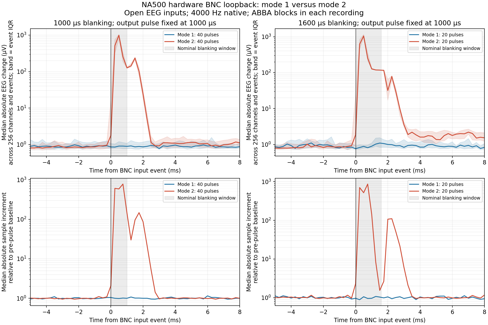

# Net Amps 500 (GES 500) AmpServer: observed behavior

There is no public documentation for the AmpServer embedded in the GES 500. This page records how it
behaves on the wire, as measured against a real unit (firmware 0.4.9, FPGA 0.6.1.f0, PCB 4.1.0.0).
`scripts/ampserver_conformance.py` reproduces every measurement here, and its recording of that unit is
in `mock/conformance/na500_fw0.4.9.json`. `MockAmpServer --amp-type NA500` emulates this behavior.

The protocol is the AmpServer protocol used by the NA400 (commands on TCP 9877, notifications on 9878,
data on 9879). Only the differences that matter to a client are listed.

## Network

- The amplifier takes an IPv4 address by DHCP and advertises itself over mDNS as service `_na500._tcp`,
  host `NA500-256ch-<serial>.local`, with TXT records `serial` and `hostname`. Some units also hold the
  static address `169.254.3.10`.
- The AmpServer listens on IPv4 only. On a network without DHCP the unit has only an IPv6 link-local
  address and cannot be reached.
- There is no ECI port (55513) and no UDP discovery port (9880).

## Sessions

- Each of the three ports accepts **one** client per session. A second client's connection succeeds at
  the TCP level but is never served. If the data client disconnects, no new data client is served until
  the session ends.
- Closing the command connection ends the session: streaming stops, the analog front end is powered
  off, and the notification and data clients are disconnected. The next client to connect starts a new
  session. A stream left running is not resumed: the next session must send `cmd_SetPower 1` and
  `cmd_Start` again.
- `cmd_SetDinEnable` persists from one session to the next.

## Commands

- Each TCP segment is one command. A second command in the same segment is ignored, so send one
  command per write and wait for its reply. A trailing extra newline or a doubled space is harmless.
- A command name the server does not recognize, or a segment that does not parse, **re-runs the
  previous command**, with the new segment's arguments where they parse. For example, after
  `cmd_NumberOfAmps`, sending `cmd_NoSuchCommand` returns the `number_of_amps` reply again.
- Replies that differ from the NA400:

  | Command | Reply |
  |---|---|
  | `cmd_ListenToAmp`, `cmd_StopListeningToAmp` sent on the **command** port | none (the client must time out) |
  | `cmd_SetDecimatedRate` / `cmd_SetNativeRate` with an unsupported rate | none |
  | `cmd_SetPower` with a value other than 0 or 1 | none |
  | `cmd_TurnAllZeroOhms`, `cmd_TurnChannelZeroOhms`, `cmd_SetMRIPulseInfo`, `cmd_SetPhoticStimSequence` | **two** `(status complete)` lines |
  | `cmd_NumberOfAmps` | `(sendCommand_return (status complete) (number_of_amps 1))` |
  | `cmd_GetAmpDetails` | as on the NA400 plus `fpga_version`, `pcb_version`, `feature_flags`; **the final `)` is missing** |
  | `cmd_GetBatteryData` | `(battery_details (time_remaining …) (master …) (slave1 …) … (slave4 …))`; one `)` short |
  | `cmd_GetBoardStatus` | `(status_details (ambient_temp …) (lpd_temp …) (fpd_temp …) (pl_temp …))`; one `)` too many |
  | `cmd_GetCurrentTime` | `(amp_status_info (current_time N))`, N = current packet counter |
  | `cmd_SetRecordingState` | `(amp_status_info (start_time N))`, N = current packet counter |
  | `cmd_GetAmpStatus`, `cmd_NumberOfActiveAmps`, `cmd_GetPhysioConnectionStatus`, `cmd_ReceiveNotifications` | bare `(status complete)`, no data |
  | `cmd_Stop` | `(status complete)` after about 1 s |
  | `cmd_SetAmpTime <epoch µs>` | `(status complete)`; sets the clock used for packet timestamps |

- Valid rates are 250, 500, 1000, 2000, 4000, 8000 and 16000 Hz, accepted by both `cmd_SetDecimatedRate`
  and `cmd_SetNativeRate`.
- The server does not shut down on `cmd_Exit`. GTEN commands and `cmd_SetFilterAndDecimate` are not
  recognized (so they re-run the previous command).

## Front end

- After power-on the EEG channels read negative full scale (-8388608 counts) until
  `cmd_SetBufferedReference 1` is sent. `cmd_Stop` switches the buffered reference off again, so send
  it after every stop (before or after `cmd_Start`; either works).
- Front-end switch commands sent within about 20 ms of the `cmd_SetPower 1` reply are lost, although
  they are acknowledged. Wait a moment after power-on before configuring.

## Physio

- The 16 physio inputs arrive in the first 8 entries of each of the packet's two physio arrays (physio
  1-8, then 9-16); the other entries are 0. They are sampled with the EEG: no relative delay at any rate
  or mode. There is no notification or reply that reports whether a Physio16 is attached.
- `cmd_SetPIBChannelGain <channel 0-15> <gain>` sets one input's gain (1, 2, 4, 6, 8, 12 or 24). At the
  power-on default of 12 the physio scale equals the EEG's (0.0447 µV per count); at gain 1 it is 12
  times coarser. Gains **persist across sessions**, so a client should set them rather than assume them.

## Triggers

- **DB9 digital inputs** (16, active low) read 0 until `cmd_SetDinEnable` is sent (its value is
  ignored), then idle at `0xFFFF`. The enable persists across sessions.
- **BNC in**: `cmd_SetBncInMode 1` (event mode) reports each rising edge as a 1 ms event in bit 2 of
  the first reserved byte: one sample at 1000 Hz, four at 4000 Hz, whatever the pulse length. Mode 0 is
  off. The mode is reset when the session ends.
- **BNC out**: `cmd_SetBncOutMode 1` (manual) makes `cmd_SetTriggerBncManualOut` fire one pulse of the
  width set by `cmd_SetBncOutPulseWidth <µs>`. Measured with a 100 kHz DAQ: a 0 to 5.0 V pulse, rising in
  under 10 µs, about 6.7% (16/15) longer than set: 100 µs gives 108, 1000 µs gives 1069, 1500 µs gives
  1600, 1600 µs gives 1706.
- Bits 0 and 1 of the same byte (photocell and audio inputs) read 1 with nothing connected.
- A BNC pulse fed to the EEG inputs starts moving the EEG on the same sample as the BNC-in event and
  reaches half amplitude about 1.5 samples later (the ADC filter's delay), at 1000 and 4000 Hz.

## Impedance

- With all channels driving (`cmd_TurnAllDriveSignals 1`, `cmd_SetOscillatorGate 1`, 20 Hz sine,
  `cmd_SetCalibrationSignalAmplitude 1023` (the maximum; a 10-bit DAC), buffered reference off) every
  channel reads ~5000 µV p-p. Switching a channel to measuring (`cmd_TurnChannelDriveSignals <ch> 0`,
  `cmd_TurnChannel10KOhms <ch> 1`) puts it behind the 10 kΩ resistor; on the measured unit about
  2 kΩ of the result is internal.
- The signal generator **latches its amplitude and frequency when the oscillator is switched on**:
  set them first, then `cmd_SetOscillatorGate 1`. Changes made while it is on do not take effect.
- The reference and common electrodes are measured in a separate ADC configuration,
  `cmd_SetCOMAndRefForMeasurement 1`: the EEG reads 0 and the reference and common signals arrive in the
  packet's REF and COM monitor fields. Each switch needs about 1.2 s to settle, and switching back
  (`… 0`) disables the DB9 inputs until `cmd_SetDinEnable` is sent again.
- `cmd_DefaultAcquisitionState` changes nothing; a client must restore the acquisition state itself.

## Notifications

Only four are sent, each after the reply to the command that causes it:

| Notification | Sent after |
|---|---|
| `(notification ntn_AmpPowerOn 9 0 -1)` | `cmd_SetPower 1` |
| `(notification ntn_AmpPowerOff 8 0 -1)` | `cmd_SetPower 0` |
| `(notification ntn_AmpStarted 10 0 -1)` | `cmd_GetStartTime` (**not** `cmd_Start`) |
| `(notification ntn_AmpStopped 11 0 -1)` | `cmd_Stop` |

There is no `ntn_PhysioConnectionStatus` and no client-connected notification. A notification can be
lost if its command is sent the instant the notification port connects, before the server has accepted it.

## Data stream

- Data flows to the data client as soon as the amplifier is powered and started; `cmd_ListenToAmp` is
  not needed and gets no reply.
- Each block is a 16-byte big-endian header (amp id 0, payload length) followed by **8** format-2
  packets (10112 bytes), at every rate.
- The packet counter restarts at 0 on every `cmd_Start`. Before that first packet the stream carries
  **leftover packets from the previous stream** (usually 1–7, occasionally more), with their old counter
  and timestamps. They can come from a previous session. Discard packets until the counter is 0.
- Timestamps are microseconds on the amplifier's clock, advancing by exactly `1e6 / rate` per packet
  truncated to an integer (62 µs at 16 kHz). The clock is not synchronized: the unit we measured was a
  month behind until a client sent `cmd_SetAmpTime`.
- The amplifier delivers at most about 7995 packets/s, while timestamps and counters advance as if
  every sample were sent. At 16000 Hz about half the samples are lost without a trace; at 8000 Hz about
  4 per second are, enough to make the sample timeline drift by milliseconds over a minute. Rates up to
  4000 Hz are delivered in full.
- If the client stops reading for a few seconds, the amplifier drops samples once about 1 MB is
  buffered; the gap shows in the packet counter. Read the data port continuously.
- With no net attached the net code is 255. Digital inputs read 0 until `cmd_SetDinEnable`, then idle at
  `0xFFFF` (active low). The first reserved byte read 3 at idle on the unit we measured.

## BNC input blanking

The FPGA needs `cmd_SetBlankingPulseWidth` (100–1600 µs) before
`cmd_SetBncInMode` = 2 to enable TMS blanking. Modes 0, 1 and 3 disable it.
Mode 2 remains armed between pulses and still produces BNC input events
(bit 2 of the first reserved byte, exposed by the connector as DIN bit 16).
The connector applies a fixed default of 1000 µs and mode 2 during stream setup,
including when joining an already-running amplifier, and after reinitialization.

### Hardware comparison, 2026-11-15

Tested serial 0001 (firmware 0.4.9, FPGA 0.6.1.f0, PCB 4.1.0.0) with BNC OUT
cabled to BNC IN, open EEG inputs, and no external signal source. Recorded all
256 EEG channels at 4000 Hz native, without LSL processing. In each recording,
the mode sequence was 1 → 2 → 2 → 1; output pulses stayed at a 1000 µs setting,
spaced 0.5 seconds apart. The blanking width was sent before each mode change.

| Blanking width | Mode 1 input events | Mode 2 input events |
|---|---:|---:|
| 1000 µs | 40/40 | 40/40 |
| 1600 µs | 20/20 | 20/20 |

All comparison blocks had contiguous packet counters and 250 µs timestamp
increments. None of the 120 analyzed event windows showed EEG saturation.
Mode 1 stayed near its roughly 1 µV background variation. Mode 2 produced a
repeatable transient, with the median absolute EEG response across channels and
events peaking around 1 mV at +0.5 ms. The later portion of the response moved
later at 1600 µs, while the output pulse width stayed unchanged. The effect
appeared in both mode-2 blocks and disappeared on return to mode 1.



These measurements demonstrate a width-dependent response in the EEG hardware
path and preserved input events. The open-input waveform is a switching
transient; this does not establish suppression of a known input signal or TMS
artifact. Its duration must not be interpreted as the exact analog gate width.
A driven-input test or direct gate measurement is still needed for those checks.

The [measurement summary](measurements/na500_bnc_blanking_20261115.json) includes
per-block event counts and continuity checks. To repeat the experiment, unlink
other AmpServer clients and run from the repository root:

```bash
python scripts/bnc_blanking_capture.py --host 10.10.10.62 \
    --out hardware_captures/bnc-1000us
python scripts/bnc_blanking_analyze.py hardware_captures/bnc-1000us
python scripts/bnc_blanking_capture.py --host 10.10.10.62 --width 1600 --pulses 10 \
    --out hardware_captures/bnc-1600us
python scripts/bnc_blanking_analyze.py hardware_captures/bnc-1600us
```

The capture utility saves complete raw PacketFormat2 payloads, command replies,
notifications and block boundaries. Analysis saves event epochs, metrics and a
plot; it needs NumPy and Matplotlib from `scripts/requirements.txt`. Acquisition
is stopped and powered down after capture. The last test width and mode 2 are
programmed before stopping; the connector reapplies its 1000 µs default on the
next stream setup. Large local recordings under `hardware_captures/` are ignored
by Git.
